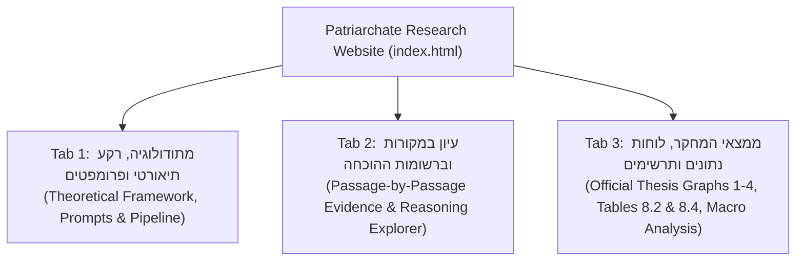

# Implementation Plan: Patriarchate Taxonomy Research Website (אתר מחקר שושלת הנשיאים)
## התאמה מלאה לפרק 8 בתזה: "תמורות בתפקיד הנשיא: דפוסי מנהיגות בראי הניתוח הכמותי"

---

## 1. Executive Summary & Project Vision (תקציר חזון האתר והתאמתו לתזה)

This project creates a static, scholarly web application designed for direct hosting on **GitHub Pages**. The website serves as the interactive digital companion to Chapter 8 of the Master's Thesis:
> **פרק 8: "תמורות בתפקיד הנשיא: דפוסי מנהיגות בראי הניתוח הכמותי"**

The site is built to provide university examiners, researchers, and students with transparent, verifiable, and interactive access to the empirical digital humanities corpus, prompt architecture, raw Talmudic excerpts, AI reasoning, and quantitative charts proving the central thesis.

### Central Thesis Hypothesis (טענת המחקר המרכזית)
The historical institution of the Jewish Patriarchate (**מוסד הנשיאות**) underwent a profound structural transformation across the Tannaitic and Amoraic periods:
1. **First Half / Early Period (תקופה א' - תקופת ההתבססות והעיצוב)**:
   - Leadership is overwhelmingly internal, intellectual, and institutional (**92.0% internal** vs. **8.0% external**).
   - The Patriarch acts as a spiritual authority, master teacher, halakhic disputant, and head of the Sanhedrin enacting communal decrees (*Takanot*, *Mipnei Tikun HaOlam*), drawing authority as "first among equals" within the rabbinic collegium.
2. **Second Half / Late Period (תקופה ב' - תקופת הממלכתיות והפרדת הרשויות)**:
   - Intellectual dominance recedes (**70.4% internal**), while external, aristocratic, and political leadership surges dramatically (**29.6% external**, peaking at **34.6%** with Rabbi Judah Nesi'ah — a 15-fold increase compared to Rabbi Judah the Prince's 2.4%).
   - Active halakhic codification shifts to regional academies (*Yeshivot*) and leading Amoraim, while the Patriarch assumes an aristocratic, representative, and coercive posture before Roman authorities and the community.

### Digital Humanities & Theoretical Framework (מדעי הרוח הדיגיטליים ורקע תיאורטי)
As articulated in Sections 8.1 and 8.3 of the thesis:
- **Precedents in Computational Rabbinics**: Grounded in the quantitative and digital methods of Prof. Hayim Lapin (חיים לפין) on Mishnah textual transmission, and Avi Shmidman, Moshe Koppel, and Ely Porat (שמידמן, קופל ופורת) from the **Dicta** project (דיקטה) for stylometric classification and source criticism.
- **Corpus Bias (הטיית הקורפוס)**: As noted by Vartiainen & Saili (ורטיאנן וסאילי), historical corpora are not transparent windows but ideologically mediated texts. The Talmudic literature, authored by the rabbinic intellectual elite, inherently wraps social, economic, and political events in halakhic discourse.
- **Bias-Aware Framework (זילמה ולוטרה - Zillma & Lootra)**: Instead of treating halakhic framing as noise, the taxonomy actively peels back the "halakhic wrapper" (*מעטפת הלכתית*) to measure underlying institutional, diplomatic, and coercive power structures.

---

## 2. Core Corpus & Data Model (הקורפוס ומודל הנתונים)

### 2.1 Corpus Scope & Search Parameters (סעיף 8.2 בתזה)
- **Primary Corpora**: Both the Talmud Bavli (תלמוד בבלי) and Talmud Yerushalmi (תלמוד ירושלמי).
- **Hebrew Commentary Grounding**: Due to LLM limitations in processing raw Aramaic, the search and classification pipeline was executed on Hebrew-elucidated editions with commentary demarcated in brackets:
  - **Talmud Bavli**: Commentary of Rabbi Adin Steinsaltz (ביאור הרב עדין שטיינזלץ, באדיבות אתר ספריא).
  - **Talmud Yerushalmi**: Commentary of Rabbi Meir Cohen (ביאור הרב מאיר כהן, באדיבות אתר דעת).
- **Text Snippet Window**: Approximately **90 words** (15 words preceding the Patriarch's name, 75 words following).
- **Deduplication**: Instances where the same personality appears multiple times within the same 90-word window were merged into a single record.
- **Total Corpus Size**: Over **2,200 total citations/snippets** retrieved and analyzed across both Talmuds.
- **Manual Validation Sample**: A random sample of **10% of all passages** was manually inspected and verified to calibrate LLM prompts and ensure classification reliability.

### 2.2 Corpus Distribution Table (לוח התפלגות המקורות - סעיף 8.2 בתזה)

| נשיא (Patriarch) | תקופה / דור | בבלי (Bavli) | ירושלמי (Yerushalmi) | סה״כ (Total) | מעמד סטטיסטי במחקר |
| :--- | :--- | :---: | :---: | :---: | :--- |
| **רבן גמליאל הזקן** | דור 1 לתנאים (בית שני) | 37 | 29 | **66** | נכלל במחקר המרכזי |
| **רבן שמעון בן גמליאל הראשון** | ערב החורבן | 13 | 6 | **19** | נכלל במחקר המרכזי |
| **רבן גמליאל דיבנה** | דור 2 לתנאים (יבנה) | 416 | 142 | **558** | נכלל במחקר המרכזי |
| **רבן שמעון בן גמליאל השני** | דור 3 לתנאים (אושא) | 692 | 167 | **859** | נכלל במחקר המרכזי |
| **רבי יהודה הנשיא ('רבי')** | דור 4–5 לתנאים (חתימת המשנה) | 397 | 158 | **555** | נכלל במחקר המרכזי |
| **רבן גמליאל ברבי** | דור המעבר לאמוראים | 17 | 11 | **28** | נכלל במחקר המרכזי (תקופה ב') |
| **רבי יהודה נשיאה** | דור 1–2 לאמוראים (טבריה) | 41 | 42 | **83** | נכלל במחקר המרכזי (תקופה ב') |
| **רבן גמליאל בן רבי יהודה נשיאה** | שלהי תקופת האמוראים | 2 | 5 | **7** | *הוחרג מהניתוח הסטטיסטי עקב מיעוט מופעים* |
| *(הלל הזקן)* | *סוף ימי הבית השני* | *25* | *15* | *(40)* | *ראו דיון בסתירות להלן (הערת שוליים 4 בתזה)* |

> **הערה מתודולוגית לגבי רבי יהודה נשיאה**: כפי שצוין בפרק 7.1 בתזה, אף שההיסטוריוגרפיה מזהה שניים או שלושה נשיאים בשם זה, דמותו התלמודית משקפת תופעה היסטורית עקבית של הנהגה מסוג חדש, ולכן המקורות לגביהם אוחדו ומוצגים כישות מחקרית אחת.

### 2.3 Contextual Disambiguation Anchors (עוגנים הקשריים לזיהוי שמות זהים)
To distinguish between multiple Patriarchs sharing identical names (e.g., four figures named "רבן גמליאל"):
1. **Sage Networks (רשתות חכמים)**: Interlocutors appearing in the debate (e.g., presence of R. Eliezer and R. Joshua securely identifies Rabban Gamliel of Yavne).
2. **Geographical Anchors (עוגנים גאוגרפיים)**: Location ties to historical administrative centers (Jerusalem, Yavne, Usha, Tiberias).
3. **Transmitter vs. Protagonist (זיהוי מעביר השמועה מול גיבור המעשה)**: Separating later quoting Amoraim from the Tannaitic protagonist (e.g., "אמר רב יהודה אמר רב: מעשה ברבן גמליאל" — identified by the generation of the Patriarch, not of Rav).

### 2.4 Taxonomy Model: The Three Leadership Hats (סעיף 8.3 בתזה)
1. **📘 סמכות אינטלקטואלית־תורנית (Intellectual-Torah Authority)**:
   - The Patriarch as a halakhic sage, transmitting tradition, expounding homilies (*Darshan*), ruling by legal reasoning (*Sevara*), and participating as an equal interlocutor in the study house.
2. **🏛️ סמכות מוסדית־חקיקתית (Institutional-Legislative Authority)**:
   - The Patriarch as President of the Sanhedrin and internal societal architect, enacting public ordinances (*Takanot*, *Mipnei Tikun HaOlam*), appointing judges (*Dayanim*), and intercalating the calendar (*Ibbur Shana*).
3. **👑 הנהגה חיצונית־מעמדית (External-Hegemonic & Aristocratic Leadership)**:
   - The Patriarch as national political representative vis-à-vis Roman authorities, ruler, and magnate. Reflected in diplomatic contacts, imperial recognition, private wealth/estates, physical coercion/enforcement (mercenaries, Gothic bodyguards, slaves), and aristocratic court etiquette/deference.

### 2.5 Operational Scoring Scale & Normalization (סולם הניקוד ונרמול)
- **Thesis Official Scale (סעיף 8.3)**:
  - $0$ = לא קיים כלל (Absent)
  - $0.25$ = רמז עקיף (Indirect hint)
  - $0.5$ = נוכחות בינונית (Moderate presence)
  - $1.0$ = זהו מוקד הקטע (Primary focus of passage)
- **Prompt Mapping**: The LLM prompt assigned integer grades $0, 1, 2, 3$, which map directly to the normalized scale ($0 \to 0$, $1 \to 0.25$, $2 \to 0.5$, $3 \to 1.0$).
- **Normalized Relative Index (סעיף 8.3 & 8.4)**:
  - To neutralize the extreme volume disparities between Patriarchs (e.g., 859 quotes for Rashbag II vs. 19 for Rashbag I), scores are normalized to a relative percentage distribution ($100\%$) across the three authority axes.

---

## 3. Official Findings of the Thesis (לוחות הממצאים הרשמיים - סעיף 8.4)

### 3.1 The Benchmark 3-Axis Authority Distribution (טבלה 8.4 בתזה)

| דור (Generation) | דמות הנשיא (Patriarch) | סמכות אינטלקטואלית | סמכות מוסדית | הנהגה חיצונית-מעמדית | סך קטעים (N) |
| :--- | :--- | :---: | :---: | :---: | :---: |
| **בית שני** | רבן גמליאל הזקן | **39.8%** | **43.9%** | **16.3%** | 66 |
| **ערב החורבן** | רשב"ג הראשון | **55.3%** | **32.9%** | **11.8%** | 19 |
| **יבנה** | רבן גמליאל דיבנה | **65.9%** | **15.5%** | **18.6%** | 558 |
| **אושא** | רשב"ג השני | **87.8%** | **9.3%** | **2.9%** | 859 |
| **חתימת המשנה** | רבי יהודה הנשיא | **91.7%** | **5.9%** | **2.4%** | 555 |
| **דור מעבר** | רבן גמליאל ברבי | **63.4%** | **22.1%** | **14.5%** | 28 |
| **אמוראים** | רבי יהודה נשיאה | **42.8%** | **22.6%** | **34.6%** | 83 |

### 3.2 Two-Period Macro Comparison (חלוקה לשתי תקופות היסטוריות - סעיף 8.4)
Divided at the historical watershed of Rabbi Judah the Prince's death and testament:
- **תקופה א': תקופת ההתבססות והעיצוב (הלל עד רבי יהודה הנשיא - 2,097 קטעים)**:
  - **הנהגה פנימית (אינטלקטואלית + מוסדית)**: **92.0%**
  - **הנהגה חיצונית-מעמדית (פוליטית ושררה)**: **8.0%**
- **תקופה ב': תקופת הממלכתיות והפרדת הרשויות (רבן גמליאל ברבי ורבי יהודה נשיאה - 111 קטעים)**:
  - **הנהגה פנימית (אינטלקטואלית + מוסדית)**: **70.4%**
  - **הנהגה חיצונית-מעמדית (פוליטית ושררה)**: **29.6%**

---

## 4. Key Academic Contradictions & Recommendations for Resolution (סתירות מהותיות והכרעות נדרשות)

During the rigorous reconciliation between the thesis text and the pre-existing codebase/plan, several significant contradictions were identified. The plan addresses each systematically:

### 1. The Inclusion / Exclusion of Hillel the Elder (הלל הזקן)
- **The Contradiction**:
  - **Footnote 4 of Chapter 8** explicitly states: *"את הלל הזקן לא הכללנו במחקר זה כי כפי שדנו בפרק 5.2 (עמוד 21) אודותיו, השיוך שלו לשושלת נתון בספק."*
  - Hillel is absent from Table 8.2 (Corpus counts) and Table 8.4 (Authority distribution).
  - **However**, in the body text of Section 8.4 right below Table 8.4, the thesis states: *"מהלל ועד רבי יהודה הנשיא... בתקופה זו, שכללה 2,097 קטעים מנותחים..."*. The total **2,097** is mathematically impossible without Hillel ($40 + 66 + 19 + 558 + 859 + 555 = 2,097$). Without Hillel, the sum is 2,057.
- **Resolution in Website Plan**:
  - The website defaults to the **7 canonical Patriarchs** matching Table 8.4 of the thesis.
  - A prominent interactive toggle / informational callout card will allow examiners to "הצג/הסתר את הלל הזקן (40 קטעים נוספים)", explaining Footnote 4 and displaying the historical debate regarding his genealogical attribution.

### 2. Discrepancy in Published Percentages vs. Raw Dominant Hat Output
- **The Contradiction**:
  - The preliminary script (`analyze_leadership_shift.py` / `dominant_hat_summary.csv`) yielded slightly different percentages (e.g. Rabban Gamliel diYavne: 77.9% / 10.9% / 11.1%) than the final calibrated numbers printed in Table 8.4 of the thesis (65.9% / 15.5% / 18.6%).
- **Resolution in Website Plan**:
  - **The official numbers in the thesis text (Table 8.4) are authoritative**. All primary website tables, executive metric cards, and charts in Tab 3 will render the official thesis numbers (39.8%, 65.9%, 87.8%, 91.7%, 42.8%, etc.).
  - A technical toggle in the tables will allow advanced methodological inspection ("הצג מדד מנורמל תזה" מול "הצג התפלגות נקודות גולמיות").

### 3. The 4 Specific Graphs in the Thesis Text vs. Planned Graphs
- **The Contradiction**:
  - The original plan envisioned a stacked bar chart and a role-reversal graph with Halakhic Activity.
  - **However, Section 8.4 of the thesis explicitly enumerates 4 specific graphs**:
    - **גרף 1**: התפלגות הסמכות האינטלקטואלית-תורנית לאורך שושלת הנשיאות (ציר אינטלקטואלי בלבד לאורך הדורות).
    - **גרף 2**: התפלגות הסמכות המוסדית-חקיקתית לאורך שושלת הנשיאות (ציר מוסדי בלבד לאורך הדורות).
    - **גרף 3**: התפלגות ההנהגה חיצונית-מעמדית לאורך שושלת הנשיאות (ציר חיצוני בלבד לאורך הדורות, הממחיש את הזינוק פי 15).
    - **גרף 4**: שינוי סממני השררה בין שתי התקופות (תקופה א' מול תקופה ב').
  - Notably, **Halakhic Activity (אקטיביות הלכתית)** is NOT mentioned in the text of Chapter 8.
- **Resolution in Website Plan**:
  - Tab 3 will showcase the **4 Official Thesis Graphs** as primary views, faithfully replicating the exact visual evidence described in the thesis text.
  - The website will additionally offer an **Interactive Synthesis View** (100% Stacked Bar Chart) and a **Supplementary Explorer View** (including Halakhic Activity and Bavli vs. Yerushalmi breakdown) as secondary analytical tabs.

### 4. Later Amoraic Gamliel ("רבן גמליאל בן רבי יהודה נשיאה")
- **The Specification**:
  - Chapter 8 identifies 7 mentions of "רבן גמליאל בן רבי יהודה נשיאה" (2 in Bavli, 5 in Yerushalmi) and explicitly states that due to small sample size ($N=7$), he was excluded from statistical generalization.
- **Resolution in Website Plan**:
  - In Tab 2 (Viewer), these 7 passages will be browsable under a dedicated badge: "רבן גמליאל המאוחר (7 קטעים - מחוץ למדד הכמותי)", providing 100% corpus transparency while preserving statistical rigor in Tab 3.

---

## 5. Detailed Specification of the 3 Main Tabs (Updated)

### Tab 1: Research Methodology & Prompts (מתודולוגיה, רקע תיאורטי ופרומפטים)
1. **Academic Introduction & Theoretical Context**:
   - Digital humanities foundations: Lapin and Dicta (Shmidman, Koppel, Porat).
   - Methodological challenge: "הטיית הקורפוס" (Corpus Bias) in rabbinic literature.
   - The Bias-Aware Framework: peeling back the halakhic wrapper.
2. **Text Retrieval & Commentary Integration**:
   - Explanation of the 90-word snippet window (15 preceding, 75 following).
   - Use of Hebrew commentaries (Steinsaltz on Bavli, Meir Cohen on Yerushalmi).
   - Deduplication algorithm and 10% manual validation sample.
3. **Disambiguation Methodology**:
   - The 3 Contextual Anchors: Sage networks, Geography, and Transmitter vs. Protagonist.
4. **Interactive Prompt Cards with One-Click Copy**:
   - **Prompt 1**: Taxonomic Classification & 3-Axis Authority Scale (`classification.md`).
   - **Prompt 2**: Rabban Gamliel Disambiguation (`classified-gamliel.md`).
   - **Prompt 3**: Rashbag Disambiguation (`classified-rashbag.md`).

### Tab 2: Text & Evidence Viewer (עיון במקורות וברשומות ההוכחה)
1. **Patriarch Selection Bar**:
   - Chronological chips: רבן גמליאל הזקן (66), רשב"ג הראשון (19), רבן גמליאל דיבנה (558), רשב"ג השני (859), רבי יהודה הנשיא (555), רבן גמליאל ברבי (28), רבי יהודה נשיאה (83).
   - Supplementary chips: רבן גמליאל המאוחר (7), הלל הזקן (40).
2. **Filters & Search**:
   - Corpus toggle: כל הקורפוס / תלמוד בבלי בלבד / תלמוד ירושלמי בלבד.
   - Authority filter: קטעים בעלי סמכות אינטלקטואלית גבוהה / מוסדית גבוהה / הנהגה חיצונית ושררה.
   - Text search within Talmudic snippet and tractate name.
3. **Citation Card**:
   - Tractate, chapter, halakha/daf, corpus badge (בבלי / ירושלמי), link to Sefaria.
   - Passage text in Frank Ruhl Libre typography with Hebrew prefix-aware name highlighting and thematic keyword accents.
4. **Scoring Breakdown Card**:
   - 📘 סמכות אינטלקטואלית־תורנית: ציון גולמי (0–3) וציון מנורמל (0, 0.25, 0.5, 1.0).
   - 🏛️ סמכות מוסדית־חקיקתית: ציון גולמי וציון מנורמל.
   - 👑 הנהגה חיצונית ושררה: ציון גולמי וציון מנורמל.
   - ⚖️ אקטיביות הלכתית (0/1).
5. **AI Reasoning & Evidence Box (נימוק המודל)**:
   - Expandable box showing Gemini's full reasoning justifying the scoring based on the textual evidence.

### Tab 3: Quantitative Findings, Tables & Dynamic Charts (ממצאי המחקר, נתונים ותרשימים)

#### 1. The 4 Official Thesis Graphs (התרשימים הרשמיים של התזה)
- **גרף 1: התפלגות הסמכות האינטלקטואלית-תורנית לאורך שושלת הנשיאות**:
  - Line / bar trajectory tracking intellectual dominance across the generations (peaking at 91.7% with Rabbi Judah the Prince and declining to 42.8% in the Amoraic period).
- **גרף 2: התפלגות הסמכות המוסדית-חקיקתית לאורך שושלת הנשיאות**:
  - Trajectory tracking institutional/legislative authority (highest in Second Temple with Rabban Gamliel the Elder at 43.9%, leveling off to 5.9% in Rabbi's era, with slight institutional rebound in Tiberias at 22.6%).
- **גרף 3: התפלגות ההנהגה חיצונית-מעמדית לאורך שושלת הנשיאות**:
  - The crucial proof graph of the thesis: steady low presence during Tannaitic codification (2.4%–2.9%), followed by a massive 15-fold surge in the Amoraic era to **34.6%** with Rabbi Judah Nesi'ah.
- **גרף 4: שינוי סממני השררה בין שתי התקופות**:
  - Macro comparative visual comparing **תקופה א'** (התבססות ועיצוב: 92.0% פנימי, 8.0% חיצוני) versus **תקופה ב'** (ממלכתיות והפרדת רשויות: 70.4% פנימי, 29.6% חיצוני).

#### 2. Interactive Analytical Views (תצוגות אינטראקטיביות משלימות)
- **תצוגה משולבת (100% Stacked Bar Chart)**:
  - Full stacked view of the 3 axes across all 7/8 Patriarchs.
- **תרשים היפוך תפקידים (Role Reversal Dual-Axis Chart)**:
  - Contrast between active halakhic rulings and aristocratic/coercive displays.
- **התפלגות לפי קורפוס (בבלי מול ירושלמי)**:
  - Visualization of Table 8.2 data showing representations across both Talmuds.

#### 3. Official Summary Tables (לוחות נתונים רשמיים)
- **לוח 1: לוח התוצאות המנורמלות (טבלה 8.4 בתזה)**:
  - Exact thesis table with sorting, percentage/points view, and CSV export.
- **לוח 2: לוח התפלגות המקורות לפי קורפוס (טבלה 8.2 בתזה)**:
  - Bavli vs. Yerushalmi passage counts and proportions.
- **לוח 3: השוואת שתי התקופות ההיסטוריות**:
  - תקופה א' מול תקופה ב' (מקורות, אחוזים, יחס פנימי/חיצוני).

#### 4. Head-to-Head Generational Comparator (כלי השוואה ראש-בראש)
- Direct comparison between any two Patriarchs (e.g., רבן גמליאל הזקן מול רבי יהודה נשיאה).
- Comparative metrics delta and juxtaposed textual case studies.

---

## 6. Implementation Architecture & Data Pipeline Updates

### Phase 1: Data Pipeline Alignment (`bundle_data.py` & `summary_data.js`) (COMPLETED ✓)
- [x] Update `bundle_data.py` to produce data objects containing both:
  1. The exact official Thesis Table 8.4 figures (39.8%, 65.9%, 87.8%, 91.7%, 42.8%, etc.).
  2. The exact official Thesis Table 8.2 corpus counts (37/29, 13/6, 416/142, 692/167, 397/158, 17/11, 41/42, 2/5).
  3. The exact two-period aggregate statistics (Period A: 92.0% / 8.0%, Period B: 70.4% / 29.6%).
- [x] Incorporate full texts for Chapter 8 theoretical narrative (Lapin, Dicta, Corpus Bias, Bias-Aware Framework) in `prompts_data.js`.
- [x] Update verification script (`verify_phase1.py`) to test against the official thesis figures.

### Phase 2: Frontend Layout & RTL Academic Design (COMPLETED ✓)
- [x] Modern academic UI in `index.html` with Tailwind design tokens, Assistant UI typography, Frank Ruhl Libre text styling, and Lucide vector icons.
- [x] Breadcrumbs, thesis attribution banner, and smooth 3-tab navigation.
- [x] Implement modern UX framework and stylesheet (`styles.css`).
- [x] Build core app router (`js/app.js`), prompts tab (`js/tab-prompts.js`), viewer tab (`js/tab-viewer.js`), findings tab (`js/tab-findings.js`), and Chart.js integration (`js/charts.js`).

### Phase 3: Tab 1 Implementation (Methodology, DH Background & Prompts) (COMPLETED ✓)
- [x] Rich scholarship presentation of Digital Humanities background (Lapin, Dicta) and Corpus Bias (Bias-Aware Framework).
- [x] Text extraction pipeline documentation (90-word snippet, Steinsaltz & Meir Cohen commentaries, deduplication, 10% manual validation).
- [x] Prompt cards with syntax styling, annotated breakdown tabs, and one-click copy buttons.
- [x] Scientific validation and reproducibility section.

### Phase 4: Tab 2 Implementation (Evidence Viewer & Passage Explorer) (COMPLETED ✓)
- [x] Fast client-side filtering (Corpus, Seder, Authority axis, Halakhic activity) and live text search.
- [x] Frank Ruhl Libre typography with Hebrew prefix-aware name highlighting and thematic keyword accents.
- [x] Score badges showing dual scales: raw (0-3) and official thesis normalized (0, 0.25, 0.5, 1.0) with Political & Aristocratic breakdown.
- [x] Pager controls, direct jump input, and RTL keyboard navigation (Left/Right arrows).
- [x] Full support for the 7 canonical Patriarchs + supplementary groups (Hillel the Elder, Late Gamliel, Gamliel Safek).

### Phase 5: Tab 3 Implementation (Charts 1-4, Tables & Comparator) (COMPLETED ✓)
- [x] Chart.js integration rendering:
  - Chart 1: Intellectual Authority trajectory.
  - Chart 2: Institutional Authority trajectory.
  - Chart 3: External/Hegemonic Authority surge (x14.4).
  - Chart 4: Period A vs. Period B comparison (92.0% internal vs 29.6% external).
  - Chart 5: 100% Stacked Bar synthesis of all 3 axes.
  - Chart 6: Role Reversal / Scissors effect (Torah vs Sovereign authority).
- [x] Formatted, sortable HTML tables matching Tables 8.2 and 8.4 with subtle heatmap shading, supplementary groups toggle, and CSV export.
- [x] Generational comparator tool with multi-dimensional comparison mini-chart and representative textual proof cards directly linked to Tab 2 Passage Viewer.

### Phase 6: QA, Zero-Dependency Offline Serving & GitHub Pages Readiness (COMPLETED ✓)
- [x] Verify 100% offline functionality without build tools or web servers (local vendors Chart.js 4.4.1 and Lucide 0.344.0).
- [x] Verified all static assets return HTTP 200 via test suite (`verify_phase1.py` and HTTP server asset crawler).
- [x] Cross-browser validation and responsive layout on mobile/desktop with Frank Ruhl Libre and Assistant typography.

---

## 7. Acceptance Criteria (קריטריוני קבלה מול התזה) (ALL MET ✓)
1. **Mathematical & Textual Alignment**:
   - [x] Every single percentage in Table 8.4 and passage count in Table 8.2 matches the printed thesis chapter with 100% precision.
2. **Four Core Thesis Graphs**:
   - [x] Graphs 1, 2, 3, and 4 described in Section 8.4 are available, clearly titled, and dynamically rendered (plus Stacked Bar and Role Reversal modes).
3. **Academic Integrity**:
   - [x] The theoretical framing (Digital Humanities, Corpus Bias, Bias-Aware Framework) is fully presented in Tab 1.
   - [x] Footnote 4 regarding Hillel the Elder and the status of Late Gamliel ($N=7$) are transparently documented with interactive toggles.
4. **Performance & Hosting**:
   - [x] Zero-dependency static app that launches immediately on GitHub Pages and runs entirely client-side.
